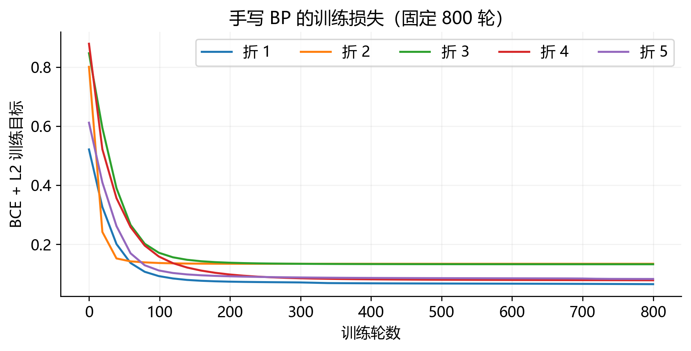
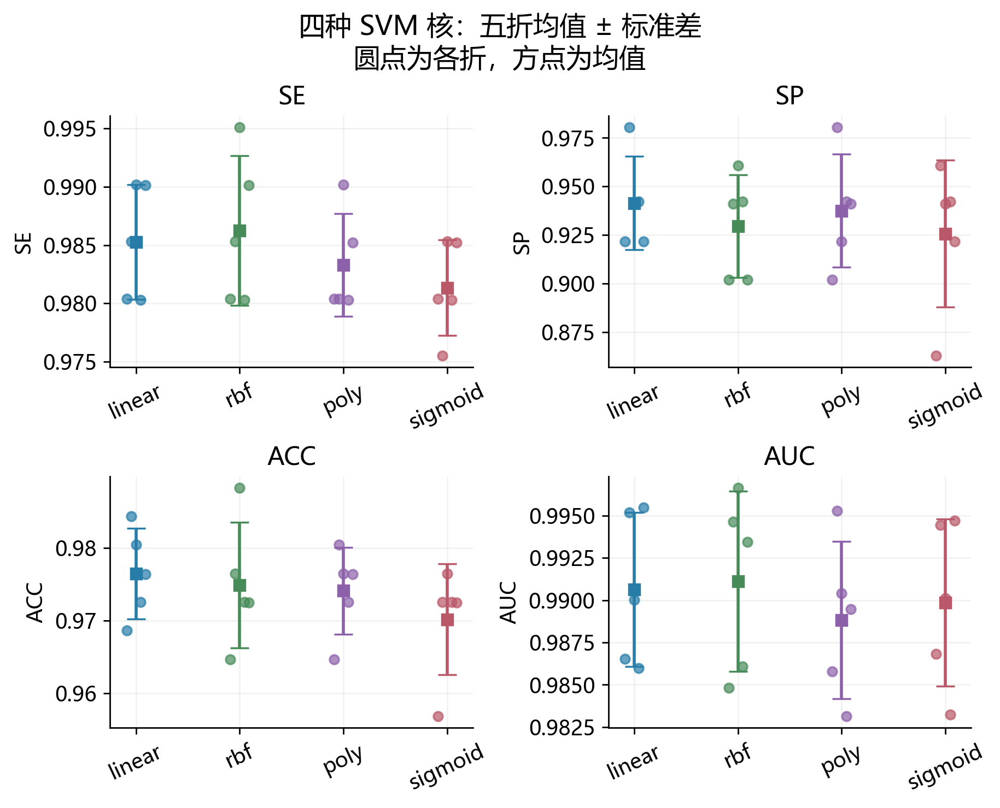
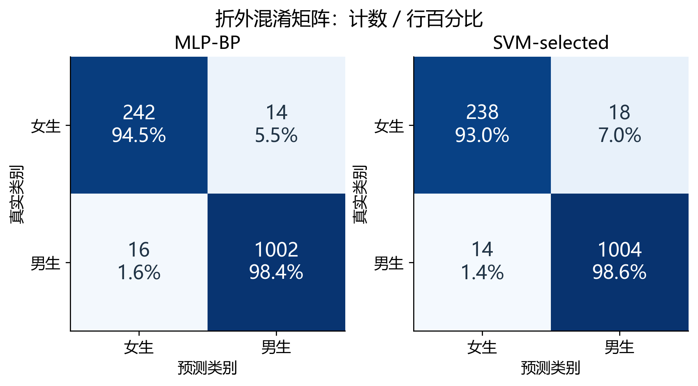
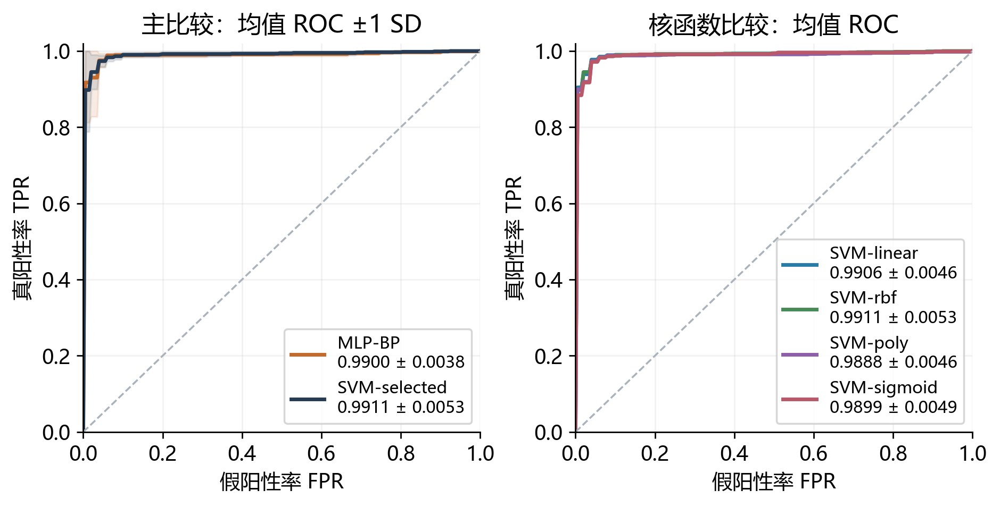
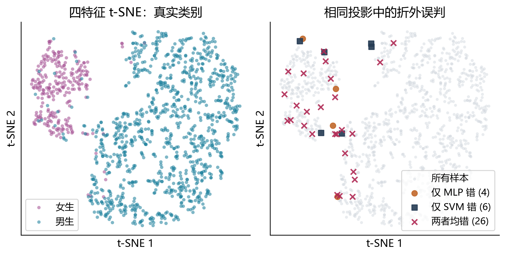

# 基于 BP 神经网络与支持向量机的男女生分类

## 一、实验任务与数据准备

### 1.1 实验目的

本次实验使用身高、体重、鞋码和50 m成绩四个特征，分别构建单隐层多层感知机（MLP）和支持向量机（SVM）男女生分类器。MLP的隐层固定为3个结点，前向传播、误差反向传播（BP）与参数更新均自行实现；SVM调用scikit-learn提供的SVC，考察线性、多项式、径向基和Sigmoid四种核。两类方法采用完全相同的五折划分，以灵敏度（SE）、特异度（SP）、准确率（ACC）和ROC曲线下面积（AUC）进行评价。

我希望通过实验回答三个问题：3个隐层结点能否在这组四维特征上学到有效的分类边界；SVM增加非线性后是否一定改善结果；当整体准确率较高时，男生和女生是否都得到了较好的识别。为此，报告把方法实现与各自结果放在同一章，再结合配对折结果和具体误判讨论两类方法的差异。

### 1.2 数据检查与处理原则

数据来自课程提供的pattern_recognition_homework_dataset.xlsx，共1280条记录。本实验仅使用性别标签及四个指定特征，编号用于核对样本和交叉验证划分。标签编码固定为女生0、男生1。5条标签缺失或不符合0/1编码的记录被排除；另有1条记录的四个特征全部缺失，不具备有效输入，因此排除。最终保留1274条，其中男生1018条、女生256条。

我在训练前固定了表1-1中的输入质量范围。缺失、非数值或越界的单个测量值统一记为缺失，不因一个特征有问题而删除整条记录。例如，身高781 cm和鞋码58超出范围；50 m列中的“×”“8，8”“7. .9”等没有直接猜测修正。处理后20条样本存在至少一个缺失特征，在每个训练折中分别计算各特征中位数，再用这些中位数填补训练与测试数据。

表1-1 特征定义、固定质量范围及缺失数量

| 特征 | 单位 | 接受范围 | 处理后缺失数 |
|---|---|---|---|
| 身高 | cm | 130–220 | 1 |
| 体重 | kg | 30–200 | 1 |
| 鞋码 | 原始鞋码 | 30–50 | 3 |
| 50 m成绩 | s | 5–20 | 17 |

注：范围端点包含在内，缺失数是在最终1274条样本中统计，且可发生于同一条记录。范围是本实验统一执行的质量规则，不代表经过验证的生理学界限。

范围内的极端值仍按规则保留，例如体重200 kg。这使处理过程不依赖类别或模型预测结果，但也意味着保留的数据仍可能含有录入噪声。全部编号唯一；相同的四特征和标签存在重复组合，由于记录精度有限且没有证据说明它们来自同一人，我没有据此删去不同编号的记录。本实验因此只保证编号层面的训练与测试分离。

### 1.3 特征标准化

身高、体重、鞋码和时间的量纲不同，直接用于梯度更新或距离核会使数值尺度较大的特征占据优势。填补之后，我用训练折的均值和总体标准差将每列标准化，并把同一变换应用到对应测试折：

$$ z_{ij}=\frac{x_{ij}-\mu_j}{s_j}. $$

其中，μ和s仅由当前训练子集估计。在内层验证中，填补和标准化也重新从内层训练子集拟合，不能先对整个数据集做标准化再划分。描述性可视化使用的数据变换单独计算，不进入模型训练或指标评价。

## 二、统一的五折评价方案

### 2.1 划分与参数选择

外层采用打乱后的分层五折交叉验证，随机种子设为23，使每折男、女生比例接近原始比例。每次用四折训练、一折测试，五次结束后，每条样本恰好有一次未参与其对应模型训练的折外预测（OOF）。MLP与所有SVM配置共用这些划分，保证模型之间的差异不是由测试样本变化造成的。

参数选择放在每个外层训练集内部，同样采用分层五折，以平均AUC为选择准则。内层选定参数后，用整个外层训练集重新拟合，再评估此前未使用的外层测试集。这样区分“选参数”和“评性能”两个环节，避免用同一组测试结果同时完成两件事[1]。本文所说的五折结果均指外层评价，内层分数只用于参数选择。

四种SVM核各自完成内层调参并报告外层结果。此外，我在同一批内层候选结果中联合选择核及参数，形成“SVM（内层选核）”流程，图表中记为SVM-selected，用它与MLP进行主比较。这个流程在每个外层测试前已经确定核函数；四核表用于理解核的行为，不将外层表现最好的核重新包装成事先选定的模型。

### 2.2 指标定义与汇总方式

全部模型统一以男生为正类。TP表示男生判为男生，FN表示男生判为女生，TN表示女生判为女生，FP表示女生判为男生。指标计算为：

$$ \mathrm{SE}=\frac{TP}{TP+FN},\qquad \mathrm{SP}=\frac{TN}{TN+FP},\qquad \mathrm{ACC}=\frac{TP+TN}{TP+TN+FP+FN}. $$

因此，SE是男生召回率，SP是女生召回率。AUC采用软件包对连续分类分数计算；MLP使用男生输出概率，SVM使用decision_function的连续判别分数。离散分类采用MLP的0.5阈值和SVM的0阈值，不在外层测试集上重新选择阈值。

主表报告五折算术均值与样本标准差。SE、SP、ACC以百分数表示，AUC保持0–1尺度；标准差反映本次划分下的折间波动，不解释为置信区间。混淆矩阵则汇总1274条OOF预测，便于查看实际错误人数。AUC先逐折计算再平均，不把不同折SVM模型未经校准的分数直接拼接计算总AUC。

男生约占79.91%。即使将所有样本都判成男生，整体ACC也能达到79.91%，但此时SP为0。因此，我会重点检查SE与SP是否均衡，而不是仅凭ACC判断模型是否有效。

## 三、BP神经网络的实现与结果分析

### 3.1 网络结构与前向传播

MLP采用4–3–1结构：输入为标准化后的四维向量，隐层3个结点使用tanh激活，输出层1个结点使用Sigmoid激活。网络共有19个可训练参数，分别来自输入到隐层的12个权重、3个隐层偏置、隐层到输出的3个权重以及1个输出偏置。反向传播通过输出误差逐层计算参数梯度，是训练隐层表征的基础[2]。

对一个含n条样本的训练批次，令Z为n×4输入矩阵，W₁为4×3权重矩阵，b₁为3维偏置，W₂为3×1权重矩阵，b₂为标量。前向计算为：

$$ H=\tanh(ZW_1+b_1),\qquad a=HW_2+b_2,\qquad p=\sigma(a)=\frac{1}{1+\exp(-a)}. $$

偏置按样本广播，H的每行是该样本的3维隐层表示。输出p用于男生分数排序，达到0.5时判为男生。3个隐层结点是作业规定的容量约束，本实验没有通过增加隐层宽度改善结果。

### 3.2 损失函数与手写反向传播

训练目标采用二元交叉熵，并仅对权重加入L2正则化，偏置不正则化：

$$ L=-\frac{1}{n}\sum_{i=1}^{n}\left[y_i\log(p_i)+(1-y_i)\log(1-p_i)\right]+\frac{\lambda}{2}(\|W_1\|_F^2+\|W_2\|_F^2). $$

交叉熵约束输出分数与标签一致，L2项限制权重过大。实际程序从输出层的原始值a计算数值稳定的交叉熵，避免对接近0的概率直接取对数。设输出层误差信号为δ₂，则Sigmoid与交叉熵组合后的梯度简化为：

$$ \delta_2=\frac{p-y}{n},\qquad \nabla_{W_2}L=H^{\mathsf T}\delta_2+\lambda W_2,\qquad \nabla_{b_2}L=\sum_i\delta_{2i}. $$

再将输出误差通过W₂传回隐层，乘以tanh的局部导数，得到：

$$ \delta_1=(\delta_2W_2^{\mathsf T})\odot(1-H^2),\qquad \nabla_{W_1}L=Z^{\mathsf T}\delta_1+\lambda W_1. $$

隐层偏置的梯度是δ₁沿样本维度求和，符号⊙表示逐元素相乘。这里的均值因子1/n只在δ₂中引入一次，传回前一层时不能再次除以n。所有梯度都基于同一次前向传播的旧参数计算完成，再统一更新参数，避免提前更新W₂改变隐层梯度。

程序只使用NumPy矩阵运算实现这条梯度链，没有调用神经网络训练器或自动求导工具。为检查实现，我对19个参数逐一进行中心差分，把扰动参数后的损失变化与解析梯度比较；这一检查验证的是梯度实现的一致性，最终分类能力仍由外层测试评价。

### 3.3 优化与参数选择

训练使用全批量Adam更新。其作用是根据每个参数的梯度一阶、二阶移动平均调整步长，梯度本身仍由上述手写BP计算。网络固定训练800轮，训练过程中不读取外层测试标签，也不依据外层测试损失早停。候选学习率为0.01和0.03，L2系数为0、0.001和0.01，共6组配置；每组以同一内层五折AUC评估，选定后重新训练外层模型。

权重采用Glorot均匀初始化，偏置初始化为0，随机数种子按训练折固定。Adam的一阶、二阶衰减系数分别为0.9和0.999，数值稳定项为10⁻⁸；程序自行维护两组移动平均并执行偏差校正。全批量意味着一次更新使用当前训练集全部样本，800轮对应800次参数更新。

我把训练轮数、网络宽度和候选范围固定下来，是为了让外层评价保持明确含义。内层分数高说明配置在训练数据内部较合适，但不保证外层测试也最好；因此报告保留各折结果及其波动，而不只展示最优一次运行。

### 3.4 训练检查与五折结果

19个参数的数值梯度检查全部通过，最大绝对误差为1.72×10⁻¹¹，最大相对误差为4.79×10⁻¹⁰。这说明当前损失函数与手写梯度在检查点上相符。图3-1显示，五次训练的目标值均由初始值持续降低后逐渐趋缓；初始损失在0.522–0.879之间，最终在0.065–0.134之间。各折的正则化系数并不相同，因此我主要据此判断优化过程是否稳定，而不把最终损失最低的一折直接当作性能最好的一折。

五折依次选出的“L2系数，学习率”为（0，0.01）、（0.01，0.03）、（0.01，0.01）、（0.001，0.01）和（0.001，0.01）。不同训练子集选择不同配置，说明在这份数据上并不存在每折都占优的同一组参数。表3-1列出各折测试结果。

表3-1 MLP的外层五折测试结果

| 折 | SE（%） | SP（%） | ACC（%） | AUC |
|---|---|---|---|---|
| 1 | 98.04 | 92.16 | 96.86 | 0.9859 |
| 2 | 98.53 | 98.04 | 98.43 | 0.9950 |
| 3 | 98.53 | 94.12 | 97.65 | 0.9904 |
| 4 | 98.03 | 94.23 | 97.25 | 0.9865 |
| 5 | 99.01 | 94.12 | 98.03 | 0.9920 |
| 均值±标准差 | 98.43±0.41 | 94.53±2.14 | 97.65±0.62 | 0.9900±0.0038 |

我首先关注到，只有3个隐层结点的网络已经取得97.65%的平均ACC和0.9900的平均AUC，说明这组四维输入能够提供较强的分类信息，较小的网络也能利用这些信息。训练ACC均值为97.78%，只比测试高0.14个百分点；训练AUC为0.9919，比测试高约0.0020。本次结果没有出现很大的训练与测试落差，但这不能替代新数据上的外部验证。

其次，SE为98.43%，仍高于SP的94.53%。从OOF计数看，14/256名女生被判为男生，16/1018名男生被判为女生：两类误判人数接近，女生的误判比例却更高。第2折只错判1名女生，第1折错判4名女生，SP因此从98.04%降到92.16%。每折只有51或52名女生，一个女生样本的判断变化就会使该折SP变化约1.9个百分点，所以SP波动大于SE并不令人意外。

这个现象也改变了我对高准确率的理解。平均损失由所有样本共同贡献，样本较多的男生在优化中占比更大；同时两类特征存在重叠。二者都可能影响默认阈值下的类别表现，但本实验没有单独改变类别权重或阈值，不能把差异完全归因于其中一个因素。

## 四、SVM的实现与不同核函数分析

### 4.1 分类原理与实现

SVM通过间隔约束和误分类惩罚确定决策边界，核函数则允许在不显式展开高维特征的情况下构造非线性分类器[3]。将标签写成tᵢ=2yᵢ−1，软间隔SVM的优化目标为：

$$ \min_{w,b,\xi}\ \frac{1}{2}\|w\|^2+C\sum_i\xi_i,\quad t_i[w^{\mathsf T}\phi(z_i)+b]\geq1-\xi_i,\quad\xi_i\geq0. $$

其中，C控制对间隔违反的惩罚强度，φ表示核所对应的特征映射。C较大时更重视训练样本上的间隔约束，但并不意味着测试表现一定更好。最终判别分数由支持向量与待测样本之间的核值加权求和得到：

$$ f(z)=\sum_{i\in\mathrm{SV}}\alpha_i t_i K(z_i,z)+b,\qquad \widehat y=\mathbf{1}[f(z)\geq0]. $$

实验使用scikit-learn 1.7.2的SVC，底层调用libsvm求解[4]。模型与中位数填补、标准化组成同一训练流程，确保每个内层、外层训练子集都独立拟合预处理。SVM的判别分数用于AUC，不解释为类别概率，也不额外开启概率校准。

### 4.2 四种核与候选设置

线性核直接利用标准化后的内积；多项式核通过幂次引入特征交互；RBF核根据样本间距离构建局部相似性；Sigmoid核对内积施加饱和非线性。四种核分别写为：

$$ K_{\mathrm{linear}}(u,v)=u^{\mathsf T}v,\qquad K_{\mathrm{poly}}(u,v)=(\gamma u^{\mathsf T}v+r)^d. $$

$$ K_{\mathrm{RBF}}(u,v)=\exp(-\gamma\|u-v\|^2),\qquad K_{\mathrm{sigmoid}}(u,v)=\tanh(\gamma u^{\mathsf T}v+r). $$

Sigmoid形式对任意数据和参数不一定满足核矩阵半正定条件[5]，因此不能直接套用前三种核的标准凸优化解释。本实验将其作为SVC支持的一种比较配置，以实际外层表现评价。

表4-1给出训练前确定的搜索范围。所有核均使用相同的C候选值，非线性核使用相同的γ候选值；多项式阶数固定为3。参数以内层平均AUC选择，而非以训练准确率选择。

表4-1 SVM核函数及内层候选参数

| 核函数 | C | γ | 固定参数 | 配置数 |
|---|---|---|---|---|
| 线性 | 0.1、1、10 | 不使用 | 不使用 | 3 |
| 多项式 | 0.1、1、10 | 0.1、0.25、1 | d=3，r=1 | 9 |
| RBF | 0.1、1、10 | 0.1、0.25、1 | 不使用 | 9 |
| Sigmoid | 0.1、1、10 | 0.1、0.25、1 | r=0 | 9 |

注：各核不使用类别权重调整。SVM（内层选核）在上述30组配置的内层结果中联合选择核和参数。候选数量与MLP不完全一致，因此本实验比较的是已说明搜索范围下的完整训练流程，而不是严格等计算量的搜索策略。

### 4.3 不同核函数的结果

表4-2汇总了四个核在同一组外层测试折上的指标。RBF的平均AUC最高，为0.9911；线性核的ACC和SP最高，分别为97.65%和94.14%。这两个排序并不相同，因此我分别讨论分数排序能力与默认阈值下的分类错误。

表4-2 四种SVM核的外层五折结果（均值±样本标准差）

| 核函数 | SE（%） | SP（%） | ACC（%） | AUC |
|---|---|---|---|---|
| 线性 | 98.53±0.49 | 94.14±2.40 | 97.65±0.62 | 0.9906±0.0046 |
| RBF | 98.62±0.64 | 92.96±2.64 | 97.49±0.86 | 0.9911±0.0053 |
| 多项式 | 98.33±0.44 | 93.75±2.91 | 97.41±0.59 | 0.9888±0.0046 |
| Sigmoid | 98.13±0.41 | 92.57±3.78 | 97.02±0.76 | 0.9899±0.0049 |

### 4.4 核函数效果的讨论

线性核的结果首先提示我，标准化后的四特征已经包含较容易用线性边界区分的信息。它的平均AUC只比RBF低约0.0005，ACC反而略高；OOF总误判30条，RBF为32条。因此，当前结果不支持“边界越复杂就一定越好”的判断。这里也不能反过来断言数据完全线性可分，因为线性核仍然存在误判。

RBF的SE略高，但SP比线性核低1.18个百分点。具体来说，RBF比线性核少错判1名男生，却多错判3名女生。这表明它在0阈值处的取舍更偏向男生，而较高AUC说明跨阈值的总体排序略有优势。内层五次联合选核均选中了RBF，因此主比较中的SVM（内层选核）恰好与本次RBF行一致；这是一项实际选择结果，并非预先强制使用RBF。其五折（C，γ）依次为（1，0.1）、（0.1，0.1）、（1，0.1）、（1，0.1）、（0.1，0.25），较大的C和γ没有在这些折中被选中。

三次多项式核的平均ACC为97.41%、AUC为0.9888，在本次候选范围内没有优于线性核。多项式交互增加了模型表达形式，但并未带来稳定的外层收益；当前数据不能说明这种差异究竟来自核的形状、固定阶数还是搜索范围，因此不把它概括为多项式核普遍较差。其训练AUC均值约0.9926，测试约0.9888，提示仅观察训练拟合会高估实际表现。

Sigmoid核的平均ACC最低，为97.02%，SP的折间标准差也最大，为3.78个百分点；第1折7/51名女生被错判，SP只有86.27%。但其平均AUC仍为0.9899，高于多项式核的0.9888。这再次说明较高排序指标与较少分类错误不是同一个目标。本实验没有进一步检查核矩阵谱，也没有扩大参数搜索，因而不能把这组结果简单解释为Sigmoid核的半正定性问题。

整体上，四个核的ACC差异不足0.7个百分点，AUC均接近0.99。我的结论是：线性核已经是有效的比较基准，RBF在当前内层AUC选择规则下更常被选中；选择哪种核，还取决于更重视排序还是固定阈值处的类别错误。

## 五、两种方法的对比与误判分析

### 5.1 整体性能与逐折配对比较

表5-1直接比较MLP与SVM（内层选核）。MLP的ACC高0.16个百分点、SP高1.57个百分点；SVM的SE高0.20个百分点、AUC高0.0012。差异方向随指标变化，没有一个方法在四项指标上同时占优。

表5-1 两种完整训练流程的外层五折结果

| 方法 | SE（%） | SP（%） | ACC（%） | AUC |
|---|---|---|---|---|
| MLP-BP | 98.43±0.41 | 94.53±2.14 | 97.65±0.62 | 0.9900±0.0038 |
| SVM-selected | 98.62±0.64 | 92.96±2.64 | 97.49±0.86 | 0.9911±0.0053 |

我进一步按相同测试折进行配对，而不是只看均值。表5-2中，SVM在第3折的AUC比MLP高0.00625，但在第1、2、4折都略低；五折中仅有两折AUC更高。第3折的较大增益拉高了均值，却不代表它在每组样本上都有优势。ACC方面，SVM一折更高、一折相同、三折更低。

表5-2 相同测试折上的差值（SVM减MLP）

| 折 | ΔSE（百分点） | ΔSP（百分点） | ΔACC（百分点） | ΔAUC |
|---|---|---|---|---|
| 1 | 0.00 | −1.96 | −0.39 | −0.00106 |
| 2 | 0.00 | −3.92 | −0.78 | −0.00038 |
| 3 | +0.98 | +1.96 | +1.18 | +0.00625 |
| 4 | 0.00 | 0.00 | 0.00 | −0.00047 |
| 5 | 0.00 | −3.92 | −0.79 | +0.00145 |

五折训练集彼此重叠，这些差值也不是五次完全独立实验。因此，我将结果解释为当前划分下的接近表现与阈值取舍，不据此声称统计显著的优越性。图5-1给出了两种方法的OOF混淆矩阵：MLP总错30条，SVM总错32条。SVM比MLP少错判2名男生，却多错判4名女生，这正是“SE略高、SP较低、ACC略低”的人数解释。

图5-2中两种方法的平均ROC曲线接近，左上角附近均较快达到较高真阳性率。图例使用原始五个AUC的均值和标准差；曲线则由各折ROC在相同假阳性率网格上插值后平均得到。阴影只是各折曲线的波动，不能作为独立重复实验的置信带，也不能因为某段阴影重叠就得出显著性检验结论。

### 5.2 两种方法是否错在同一些样本上

我把两个模型的OOF结果逐条对齐，得到表5-3。26条样本被两种方法共同误判，占MLP全部30条误判的86.7%，占SVM全部32条误判的81.3%。只有10条样本属于“一种方法对、另一种方法错”。这说明替换分类器对少数样本确实有影响，但大部分错误是两种方法共有的。

表5-3 两种方法的OOF错误重叠

| 判断情况 | 女生 | 男生 | 合计 |
|---|---|---|---|
| 两者均正确 | 237 | 1001 | 1238 |
| 仅MLP错误 | 1 | 3 | 4 |
| 仅SVM错误 | 5 | 1 | 6 |
| 两者均错误 | 13 | 13 | 26 |

共同误判的13名女生，其平均身高167.92 cm、体重58.54 kg、鞋码39.50、50 m成绩7.87 s；共同判断正确的女生相应均值为163.04 cm、51.68 kg、37.29和8.97 s。共同误判的女生在这些均值上更接近男生特征方向。共同误判的13名男生则平均身高162.62 cm、体重52.00 kg、鞋码37.38、50 m成绩8.55 s，呈现相反方向。这里按各列有效观测计算均值，比较仅用于描述，不能由此断定标签有误。

我又查看了具体记录。匿名行号row_0022的标签为男生，四特征为（156 cm，47 kg，36码，9.5 s），两种方法均判为女生；row_0089的标签为女生，特征为（166 cm，56 kg，40码，8.5 s），两者均判为男生。这些例子帮助我理解，模型依据的是四特征的组合模式，无法仅凭当前输入保证每个人都被正确识别。特征重叠、测量误差和标签噪声都可能产生这类现象，目前证据不能区分它们各自的影响。

图5-3左侧可以看到两个主要类别区域，以及少量落在另一类区域中的样本；右侧将共同误判与各方法单独误判叠加到相同坐标。这个图与前面的错误重叠统计相互补充，但二维图并不是模型实际使用的决策空间。t-SNE只在原始四特征经独立填补、标准化后作描述性降维，既不输入分类器，也不参与调参或指标计算；投影中的间距和区域形状不能当作分类性能的定量证明。

t-SNE的困惑度设为30，采用PCA初始化和自动学习率，迭代1000次，随机种子为23。图中标签只用于着色，错误标记来自已经完成的OOF预测。

### 5.3 结果适用范围

本次结论来自同一份课程数据和一次固定随机种子的嵌套五折。输入质量规则保留了范围内极端值，且缺少更细的个体来源信息；有限的参数网格也不能覆盖所有可能的MLP或SVM设置。因此，结果支持“在当前四特征、数据和评价流程下两者均有效”，不能推出在其他人群或参数范围中同样排序。

如果继续实验，我会优先增加独立数据或重复外层划分，检查这个很小的差异是否稳定；若任务更重视女生识别，再在训练数据内部评估类别权重或阈值调整。目前报告中的数字只对应已经执行的实验，这些后续方案没有计入结果。

## 六、实验总结与体会

本实验完成了手写4–3–1 BP网络和四核SVM的分类实现，并用同一套五折评价比较其表现。手写BP的梯度校验与训练曲线使我能够把链式求导、参数更新和实际收敛联系起来；SVM的核比较则表明，非线性形式增加了可选边界，但并不会自动带来更少的测试错误。

在主比较中，MLP的平均ACC为97.65%、AUC为0.9900；内层选核SVM的平均ACC为97.49%、AUC为0.9911。对我而言，比这几个均值更有价值的是它们背后的差异：MLP在默认阈值下的女生召回率较高，SVM的平均排序略高，而26条共同误判说明两者面对不少相同的困难样本。因此，评价分类器应同时考虑排序能力、两类错误及划分波动，不能把一个略高的指标当作全面更好的证据。

Notebook保存了完整实现、运行输出和结果图表；五折划分、候选搜索分数、逐条OOF预测与数据文件哈希同时保存于results/homework2，便于复核报告中的统计量。实验使用Python 3.10.19、NumPy 2.2.6、scikit-learn 1.7.2，基础随机种子为23。

## 参考文献

[1] scikit-learn developers. Nested versus non-nested cross-validation[EB/OL]. scikit-learn 1.7.2 documentation. https://scikit-learn.org/1.7/auto_examples/model_selection/plot_nested_cross_validation_iris.html（访问日期：2026-10-13）.

[2] Rumelhart D E, Hinton G E, Williams R J. Learning representations by back-propagating errors[J]. Nature, 1986, 323: 533–536. DOI: 10.1038/323533a0.

[3] Cortes C, Vapnik V. Support-vector networks[J]. Machine Learning, 1995, 20: 273–297. DOI: 10.1007/BF00994018.

[4] scikit-learn developers. SVC[EB/OL]. scikit-learn 1.7.2 documentation. https://scikit-learn.org/1.7/modules/generated/sklearn.svm.SVC.html（访问日期：2026-10-13）.

[5] LIBSVM authors. LIBSVM FAQ: How do I choose the kernel?[EB/OL]. https://www.csie.ntu.edu.tw/~cjlin/libsvm/faq.html（访问日期：2026-10-13）.
